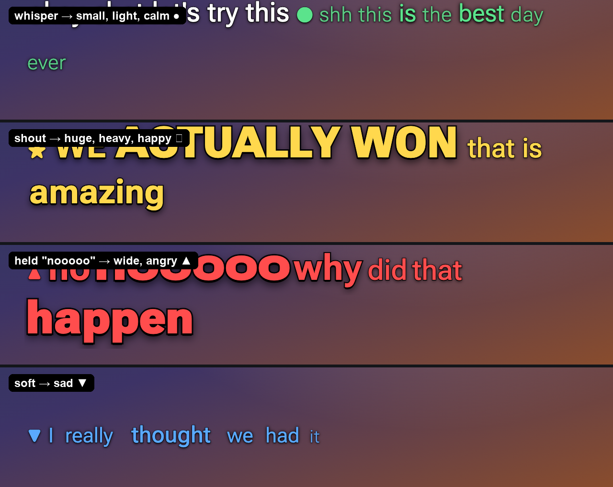
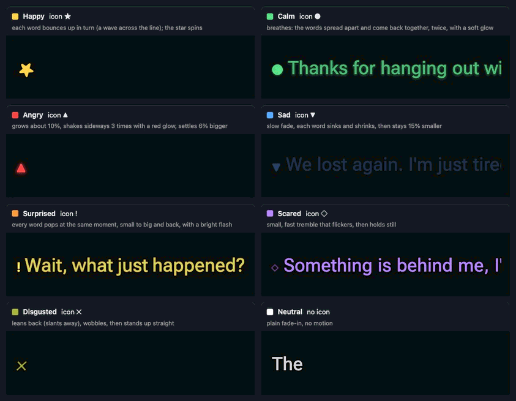
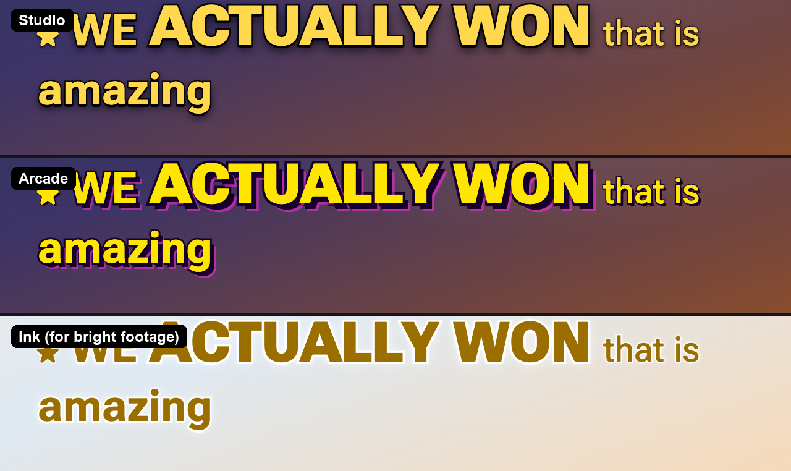
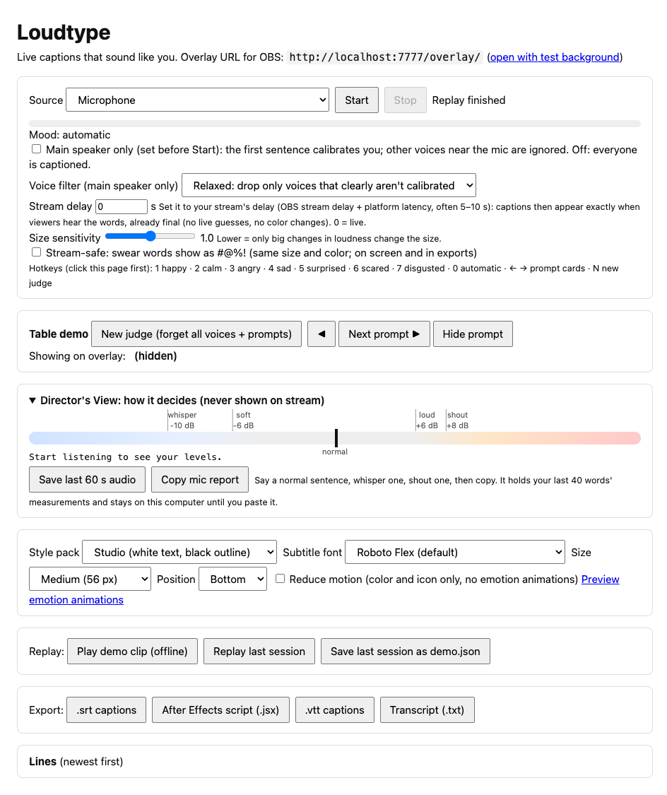

# Loudtype

**Live captions that sound like you.**

Your voice has volume, length and feeling. Normal captions throw all three away. Loudtype keeps them: it's a live caption overlay for streamers where loud words are big and heavy, whispers are small and light, held words stretch wide, and each line is tinted with its emotion. Every word stays on one shared baseline, so it reads like captions and not like a ransom note.

Built at **Hacklanta '26** for the Creative track (Adobe). Also entered for MLH Best Use of ElevenLabs and the Zero Data Challenge.

<p align="center">
  
  <br><sub>The overlay playing the built-in offline demo clip (<code>replay/demo.json</code>), recorded from <code>/overlay/</code>. In OBS the background is transparent.</sub>
</p>

---

## What it does

| You do this | The captions do this |
|---|---|
| Whisper | Small, thin, light type |
| Talk normally | Regular captions |
| Get loud / shout | Bigger and bolder, up to 1.6× size and full weight, with a small pop |
| Hold a word ("nooooo") | The word gets wider (Roboto Flex's width axis) |
| Sound happy, calm, angry, sad, surprised, scared or disgusted | The line is tinted, gets an icon (★ ● ▲ ▼ ! ◇ ✕) and plays one short animation |

<p align="center">
  
</p>

Each visual property means exactly one thing:

- **Size + weight = loudness**: whisper 0.75× / 220, soft 0.9× / 350, normal 1× / 450, loud 1.25× / 700, shout 1.6× / 1000
- **Width = how long a word was held**
- **Color + icon + animation = emotion.** Color is never the only signal; the icons are there for colorblind viewers, and there's a colorblind palette too.
- **When in doubt, stay white.** A white line beats a wrong color, so lines are only tinted when the model is confident.

### One animation per emotion

<p align="center">
  
</p>

Happy bounces in a wave, calm breathes, angry shakes and stays a little bigger, sad sinks and stays smaller, surprised pops all at once, scared trembles, disgusted leans away. Each one plays **once**, when the line's emotion is final. **Reduce motion** (a checkbox, `?motion=reduce` or the OS setting) turns them all off and keeps color and icons. You can see them all on `/overlay/preview.html`.

### Style packs

<p align="center">
  
</p>

**Studio** (white text, black outline), **Arcade** (neon, heavy outline, hard shadow) and **Ink** (dark text with a light outline, for bright footage). The type rules are the same in every pack. You also pick:

- **Font:** Roboto Flex (default, the only one with a width axis), Comic Neue, Inter, Atkinson Hyperlegible Next
- **Size:** 44 / 56 / 72 / 90 px
- **Position:** bottom or top

---

## How it works

```
Control panel (Chrome, /control/)              Overlay (/overlay/, OBS Browser Source)
  mic or tab audio → AudioWorklet                 draws words on one baseline per row,
    ├─ 33 ms frames: loudness (dB) + voicing ─┐   roll-up rows, fades, colors, icons,
    └─ 100 ms 16 kHz PCM → ElevenLabs Scribe  │   one animation per emotion
  Scribe realtime: partial / committed words  │                ▲
    + word timestamps ────────────────────────┤   ws://localhost:7777/relay
  prosody.js: loudness level per word ◄───────┘   (server.js just passes events on
  emotion: on-device GoEmotions + voice tone        and stores nothing)
```

1. **Hearing.** The control panel takes your mic (auto gain and noise suppression are turned **off**, because they'd flatten your loudness) or a browser tab's audio. An AudioWorklet measures every 33 ms frame: its level in dB and how *voiced* it is (vocal cords vibrating or not, which is how a whisper is told apart from soft speech). It streams 16 kHz audio to **ElevenLabs Scribe realtime**, which sends back words with timestamps.
2. **Loudness.** Your first few voiced words set *your* normal level, then each word is measured in dB against it: whisper ≤ −10 dB (or mostly unvoiced), soft ≤ −6, loud ≥ +6, shout ≥ +8. It works on any mic because it's relative to you. A sensitivity slider scales the thresholds.
3. **A cleaner second pass.** Each finished line's audio is sent once more to Scribe's batch model (`scribe_v2`) for better words, punctuation and **sound tags** (`[laughs]`, `[sighs]`, `[applause]`), which show up as small italic captions.
4. **Emotion, on this computer.** A GoEmotions model (`SamLowe/roberta-base-go_emotions-onnx`, run with transformers.js) reads the words, a stream-slang layer catches things like "let's gooo", and your **tone of voice** (pitch, pitch range, loudness and pace compared to your own normal) decides between high and low energy. So *positive + energetic → happy ★*, *positive + quiet → calm ●*, *negative + energetic → angry ▲*, *negative + quiet → sad ▼*, plus surprised, scared and disgusted.
5. **Drawing.** The overlay is a transparent web page for OBS. Captions roll up in one lane, at most two rows. Words fade in one by one, and rows only break where earlier words already decided it, so nothing jumps around as words arrive.

### Extras

- **Sync mode (stream delay).** Streams usually run 5–10 s behind. Enter your delay and Loudtype holds each finished line, then plays its words at exactly the moment viewers of the delayed stream hear them, already final with no live guesses. The panel suggests a delay from measured timings.
- **Main speaker only.** For a loud room, the first sentence makes an on-device **voiceprint** (WeSpeaker ResNet34) of you, and lines from other voices near the mic are dropped. A gate and pitch/level rules handle the rest. Off by default; normally everyone is captioned.
- **Teach your tones.** The prompt cards have you say one sentence in your neutral, happy, angry and sad voice. Later lines that *sound* like one of those moods take it on, even when the words themselves are neutral.
- **Voice emotion (optional).** A local `emotion2vec_plus_large` service can color lines whose words are neutral, but only when it's ≥ 90% sure.
- **Stream-safe.** Swear words and slurs show as `#@%!` with the same size, weight, color and timing, on screen and in exports. It's tested against look-alikes like *Scunthorpe*, *class* and *cocktail*.
- **Streamer stays in charge.** Hotkeys 1–7 force a mood, 0 goes back to automatic.
- **Director's View.** A panel that's never on stream: the live level against your thresholds, the room's noise floor, why each word got its size, and a **Copy mic report** for tuning a new mic.

### Exports: live tonight, editable tomorrow

After a session you can export:

- **`.srt`** captions
- **`.vtt`** (WebVTT) with per-word timing and loudness/emotion style classes
- A plain **transcript** `.txt` with timestamps and moods, for show notes
- An **After Effects script** (`.jsx`): one text layer per line, the loudest and most emotional moments marked on a *Highlights* null, and each emotion's animation rebuilt as AE text animators that fire on the real word times. *(It hasn't been run inside After Effects yet; see Status.)*

---

## The control panel

<p align="center">
  
</p>

The control panel is plain on purpose: it's the streamer's backstage view and never appears on stream. It covers the source (mic or tab audio), Start/Stop, main-speaker mode, stream delay, size sensitivity, stream-safe, prompt cards for live demos, Director's View, the look (pack, font, size, position, reduce motion), replay and export.

---

## Quick start

**You need:** Node.js 22+, Google Chrome, and an [ElevenLabs](https://elevenlabs.io) API key with speech-to-text access. A headset or clip-on mic works much better than a laptop mic.

```bash
git clone https://github.com/VivekVenigalla/loudtype.git
cd loudtype
npm install
npm run setup                    # one-time: downloads the emotion + voiceprint models and fonts (~200 MB) into models/ and fonts/
cp config.example.js config.js   # then paste your ElevenLabs API key into config.js
npm start
```

Then open:

- **Control panel:** <http://localhost:7777/control/> in Chrome. Click **Start**, allow the mic, and say one normal sentence to calibrate.
- **Overlay:** <http://localhost:7777/overlay/>. In OBS go to *Sources → Browser*, paste the URL, and set 1920 × 1080. Add `?bg` to see it over a checkerboard in a normal browser.

**No key, no network?** Click **Play demo clip (offline)** in the control panel. It replays `replay/demo.json` on the overlay, and that's exactly what the GIF at the top shows.

### Overlay URL options

The overlay can be locked to a look for OBS, and URL parameters win over the control panel:

```
http://localhost:7777/overlay/?pack=ink&size=l&position=top&font=readable&motion=reduce
```

| Parameter | Values |
|---|---|
| `pack` | `studio`, `arcade`, `ink` |
| `size` | `s`, `m`, `l`, `xl` |
| `position` | `bottom`, `top` |
| `font` | `flex`, `comic`, `pro`, `readable` |
| `motion` | `reduce` |

### Caption a real stream

Set **Source → Tab audio**, click Start, pick the tab that's playing a Twitch or YouTube stream, and tick **Also share tab audio**. Loudtype captions it like a mic. Speech-to-text minutes come out of your ElevenLabs quota, so keep test runs short.

### Optional: voice-emotion service

```bash
npm run emotion2vec:setup    # one-time: Python venv with torch + funasr
npm run emotion2vec          # separate terminal; serves on 127.0.0.1:7790, downloads ~1.2 GB once
```

Loudtype uses it automatically while it's running and ignores it when it's not.

### Hotkeys (control panel)

| Key | Action |
|---|---|
| `1`–`7` | Force a mood: happy, calm, angry, sad, surprised, scared, disgusted |
| `0` | Back to automatic |
| `←` `→` | Previous / next prompt card |
| `N` | New judge (forget the voice and restart the prompts) |

---

## Privacy

- **No accounts, no analytics.** Nothing is written to disk unless you click Export or Save.
- **Emotion runs on your computer.** The emotion, tone and voiceprint models are local. Caption text isn't sent to any AI service.
- **The only outside service is ElevenLabs**, for speech-to-text. Your API key stays in `config.js` on the local server; the browser only gets a single-use token.
- **The local server is locked down.** It only answers `localhost` requests, so other websites can't reach it through DNS rebinding. The relay only accepts its own pages. Only whitelisted folders are served, so `config.js` and `server.js` never are.

> **Note:** Loudtype asks ElevenLabs not to retain audio, but zero-retention mode is only available on enterprise plans, so on a regular plan ElevenLabs may keep audio logs.

---

## Project layout

```
server.js            Local server: static files, single-use Scribe tokens, /relay WebSocket, second-pass proxy
control/             Control panel (browser)
  audio.js, pcm-worklet.js, features.js   mic/tab capture, per-frame dB + voicing + pitch
  stt.js, transcript.js                    Scribe realtime client, partial → commit state machine
  prosody.js, tone.js                      loudness levels, width, voice tone vs. your normal
  emotion.js, emotion-core.js              on-device GoEmotions + slang + tone → emotion
  voiceprint*.js, gate.js                  main-speaker-only filter
  sync.js, safe.js, export.js, relay.js    stream delay, stream-safe, exports, replay recording
overlay/             OBS overlay: render.js (roll-up layout), fx.js (emotion animations), style.css (packs)
emotion2vec/         Optional Python voice-emotion service
scripts/             Setup, demo generator, evaluation scripts
test/                node:test suite (no network, no models)
replay/demo.json     Offline demo clip
```

## Testing

```bash
npm test             # 192 tests, a few seconds, no network: server security, transcript state machine, prosody, emotion, exports, sync...
npm run typecheck    # tsc over the JSDoc-typed modules
```

The evaluation scripts in `scripts/` measure the real pipeline. Some of them use ElevenLabs quota.

| What | Result | Script |
|---|---|---|
| Emotion on streamer-style lines we didn't tune on | **18/20** right (a plain positive/negative model: 12/20) | `node scripts/eval-emotion.mjs` |
| Same words, different voice (whispered vs. shouted, etc.) | **8/8** | `node scripts/eval-emotion.mjs` |
| Loudness level per word on a clip with known levels | **46/51** exact, **51/51** within one level | `node scripts/eval-volume.mjs` (uses quota) |
| Main speaker only: main speaker kept / nearby talker captioned | **35/35** kept, **1/14** captioned | `node scripts/eval-ballroom.mjs` (uses quota) |
| Voiceprint: lines assigned correctly | **8/8** on both mic models | `node scripts/eval-voiceprint.mjs` |

These numbers come from synthetic and TTS voices with real Scribe timing. Real people in real rooms haven't been measured systematically yet.

## Status

**Tested:** the full pipeline end to end in Chrome with real Scribe (fake-mic and real-mic runs), AirPods (whispers 7/7, shouts +8…+10 dB) and the MacBook Air mic. Without a headset, whispers are only caught by voicing.

**Not yet tested:**

- The After Effects `.jsx` export has never been run inside After Effects.
- Venue-level background noise.
- Voiceprints with two real people.
- Held-word width with live speech (only tested synthetically).

## Built with

- [ElevenLabs Scribe](https://elevenlabs.io/speech-to-text): realtime and batch speech-to-text with word timestamps and audio-event tags
- [transformers.js](https://github.com/huggingface/transformers.js) + ONNX Runtime Web: on-device GoEmotions and WeSpeaker voiceprints
- [emotion2vec](https://github.com/ddlBoJack/emotion2vec) (optional): voice emotion
- Web Audio AudioWorklet, Web Animations, WebSockets ([`ws`](https://github.com/websockets/ws), the only runtime dependency of the server)
- Fonts (SIL OFL): Roboto Flex, Comic Neue, Inter, Atkinson Hyperlegible Next
